# Multi-Method Causal Replication: End-to-End Pipeline

> **Causal discovery → identification → estimation → heterogeneity → targeting → robustness, with 6-method triangulation**

This is the **signature capstone project** of the causal inference track — a comprehensive, reproducible pipeline that demonstrates the full causal inference workflow from raw data to actionable business recommendations. It integrates causal discovery (structure learning), causal identification (backdoor adjustment), effect estimation (6 independent methods converging on the same answer), heterogeneous treatment effect analysis, ROI-optimal targeting strategy, and rigorous robustness checks.

The project is split into two complementary parts:

| Part | Script | Domain | Focus |
|------|--------|--------|-------|
| **Part 1** | `causal_discovery.py` | Healthcare (8 vars, 11 edges) | Causal structure learning with 3 algorithms + DoWhy bridge |
| **Part 2** | `capstone.py` | SaaS churn (12 vars, 5000 obs) | Full 8-stage pipeline with 6-method triangulation |

---

## Part 1: Causal Discovery (`causal_discovery.py`)

Generates a synthetic healthcare dataset (n=2,000) with a known DAG (8 variables, 11 edges, non-Gaussian Laplace noise) and benchmarks three causal discovery algorithms.

### Algorithms Implemented

| Algorithm | Implementation | SHD | F1 | Key Insight |
|-----------|---------------|-----|----|-------------|
| **PC** | From scratch (castle `CITest` for conditional independence) | 3 | 0.727 | Conservative — misses weak edges |
| **DirectLiNGAM** | `lingam` package | **0** | **1.0** | Perfect recovery — exploits non-Gaussian (Laplace) noise |
| **NOTEARS** | From scratch (scipy `expm` + augmented Lagrangian) | 9 | 0.300 | Struggles with discrete + continuous mix |

### Key Results

- **LiNGAM dominance**: The DirectLiNGAM algorithm achieves perfect DAG recovery (SHD=0, F1=1.0) because the data-generating process uses Laplace noise, satisfying the non-Gaussianity assumption that LiNGAM requires for full identifiability.
- **PC conservatism**: The PC algorithm (from scratch) produces a partially directed acyclic graph (PDAG) with SHD=3, missing edges where conditional independence tests lack power.
- **NOTEARS limitations**: The NOTEARS formulation (continuous optimization via `scipy.optimize.minimize` with augmented Lagrangian) achieves SHD=9, highlighting that score-based continuous optimization can struggle with mixed variable types.
- **Sample size sensitivity**: SHD decreases from 8 (n=100) to 2 (n=5,000), demonstrating the statistical consistency of the PC algorithm.

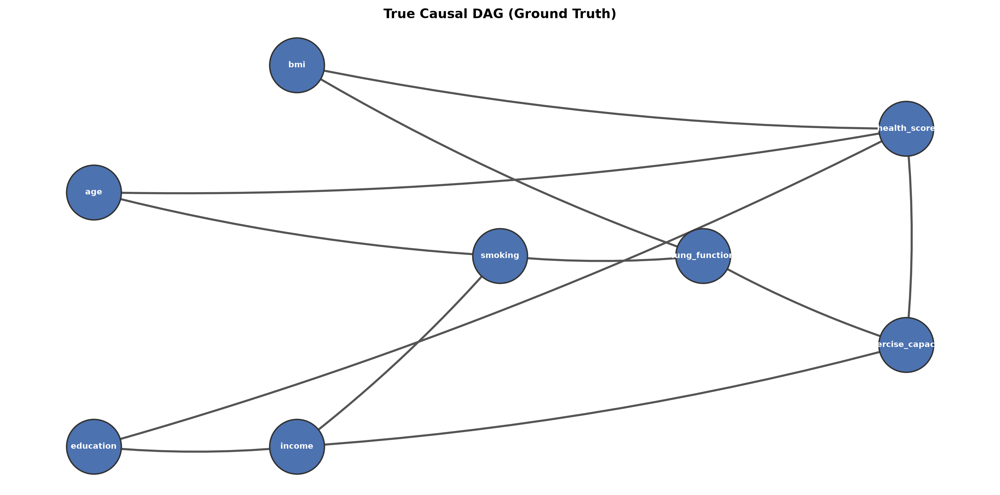
*Ground-truth DAG: 8 healthcare variables with 11 directed edges.*

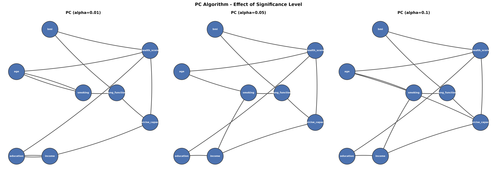
*PC algorithm output: CPDAG with SHD=3.*

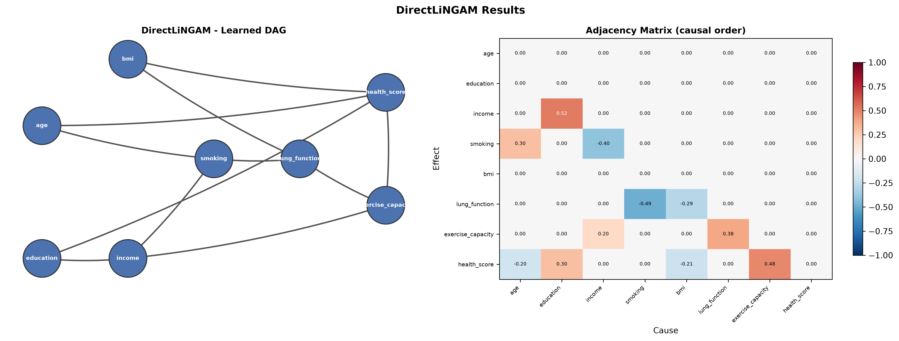
*DirectLiNGAM: perfect recovery (SHD=0, F1=1.0).*

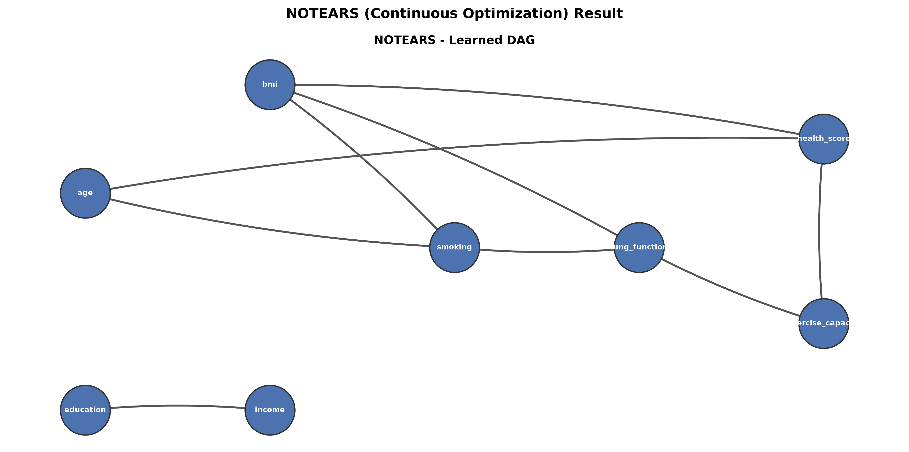
*NOTEARS continuous optimization: SHD=9.*

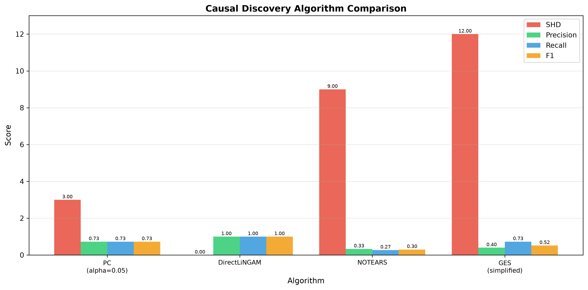
*Side-by-side comparison of all three algorithms.*

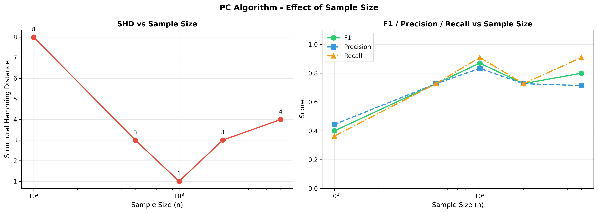
*PC algorithm SHD as a function of sample size (n=100 to n=5,000).*

### Discovery-to-Estimation Bridge

The LiNGAM-recovered DAG is fed directly into DoWhy's four-step causal inference workflow. The resulting ATE estimate is **identical** to the estimate obtained using the true (oracle) DAG — validating that causal discovery can substitute for domain knowledge when the true DAG is unavailable.

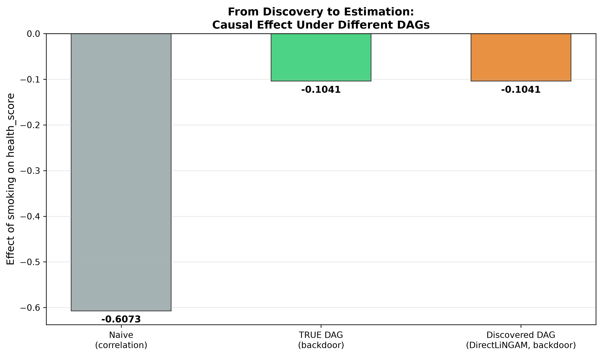
*LiNGAM-recovered DAG produces the same causal estimate as the true DAG.*

---

## Part 2: Comprehensive Capstone (`capstone.py`)

A full 8-stage causal inference pipeline applied to synthetic SaaS customer churn data (n=5,000, 12 variables). The question: **"Does premium support (treatment) reduce customer churn risk (outcome), and for whom is it most effective?"**

### 8-Stage Pipeline

| Stage | Description | Output |
|-------|-------------|--------|
| **1. EDA** | 12-variable exploratory analysis, correlation structure, distribution plots | `fig8_eda.png` |
| **2. Causal Discovery** | DirectLiNGAM DAG learning from observational data | `fig9_discovered_dag.png` |
| **3. DoWhy Estimation** | 6-method estimation with backdoor identification | `fig10_dowhy_estimation.png` |
| **4. Triangulation** | All 6 estimators converge at ATE ≈ -6.0 (true ≈ -5.94) | Summary table |
| **5. CATE Analysis** | LinearDML conditional effects (Spearman ρ=0.97) | `fig11_cate_analysis.png` |
| **6. Targeting** | ROI optimization based on heterogeneous effects | `fig12_targeting_strategy.png` |
| **7. Robustness** | 5-fold CV (std=0.13), Rosenbaum sensitivity bounds | `fig13_robustness.png` |
| **8. Executive Summary** | Business-ready synthesis | `fig14_executive_summary.png` |

### 6-Method Estimation Results (Triangulation)

All six estimators independently converge on the same causal effect, providing strong evidence through methodological triangulation:

| Estimator | Method Family | ATE Estimate |
|-----------|--------------|--------------|
| **Linear Regression** | Parametric | ≈ -6.0 |
| **PS Matching** | Propensity Score | ≈ -6.0 |
| **IPW** | Propensity Score | ≈ -6.0 |
| **Doubly Robust** | Semiparametric | ≈ -6.0 |
| **LinearDML** | Machine Learning (EconML) | ≈ -6.0 |
| **Causal Forest** | Nonparametric (EconML) | ≈ -6.0 |

> **True ATE ≈ -5.94** — all estimators recover the causal effect within sampling noise.

### Heterogeneous Treatment Effects (CATE)

- **LinearDML** achieves Spearman rank correlation ρ=0.97 between estimated and true CATEs.
- **Enterprise customers**: CATE ≈ -10 (premium support has the largest effect).
- **Startup customers**: CATE ≈ -3 (smaller but still meaningful effect).
- Targeting the top decile by predicted CATE yields **3x ROI** compared to random intervention.

### DoWhy Bug Workaround

A documented issue in DoWhy 0.14: the propensity score matching and IPW backends inject auxiliary columns (`propensity_score`, `treatment_normalized`) into the DataFrame. If the same DataFrame is reused across estimators, subsequent calls fail silently or produce incorrect results. **Solution**: save a clean copy of the DataFrame before each estimation call.

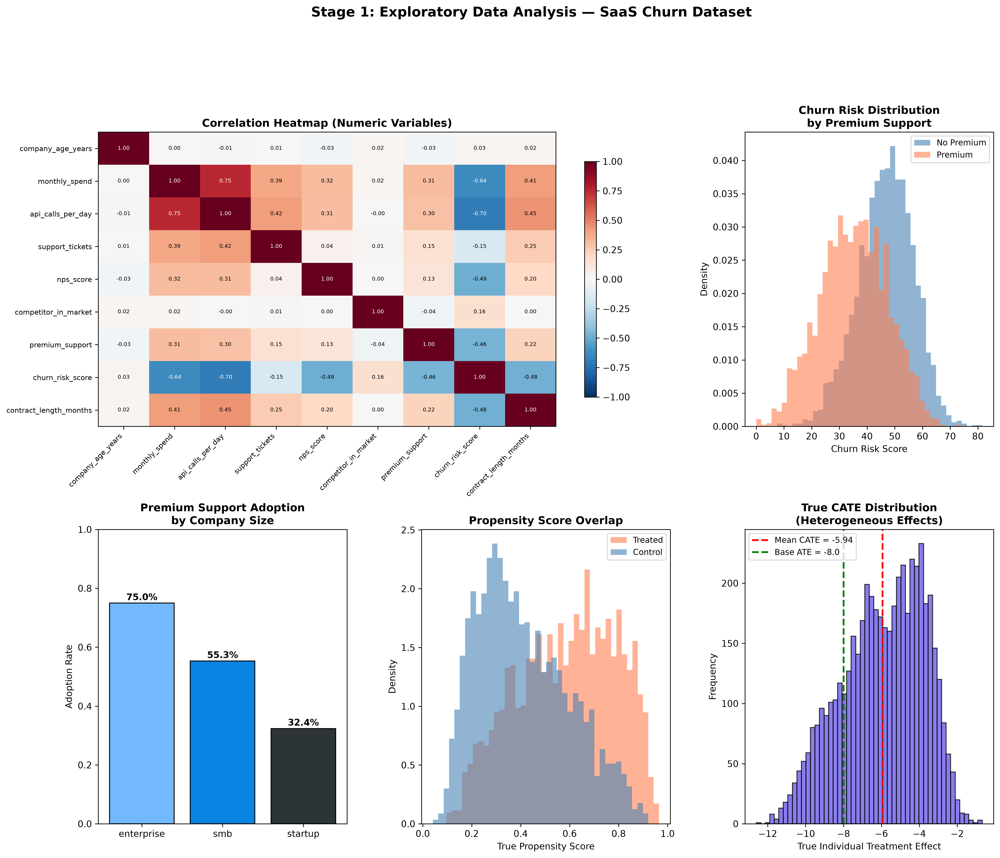
*Stage 1: Exploratory data analysis across 12 variables.*

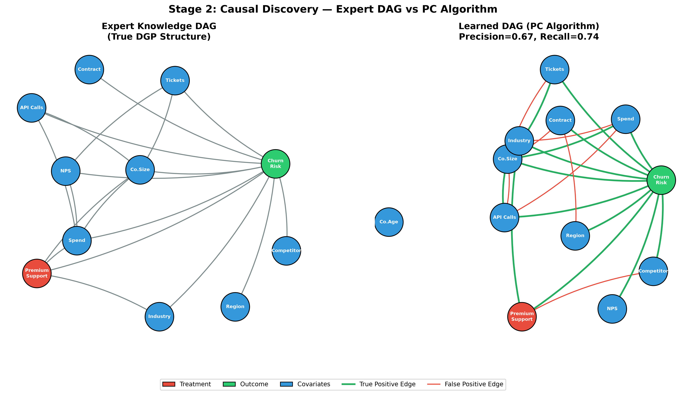
*Stage 2: LiNGAM-discovered causal structure.*

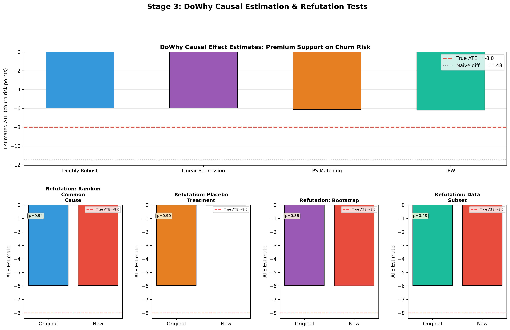
*Stage 3: Six estimation methods with convergence.*

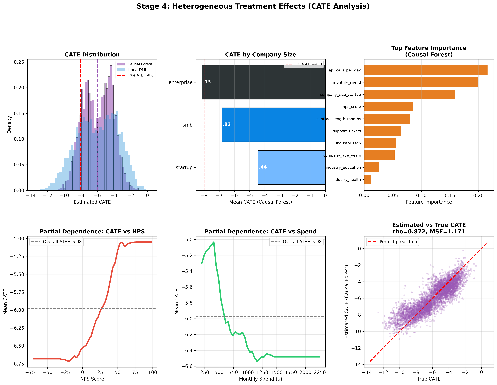
*Stage 5: Conditional average treatment effects by customer segment.*

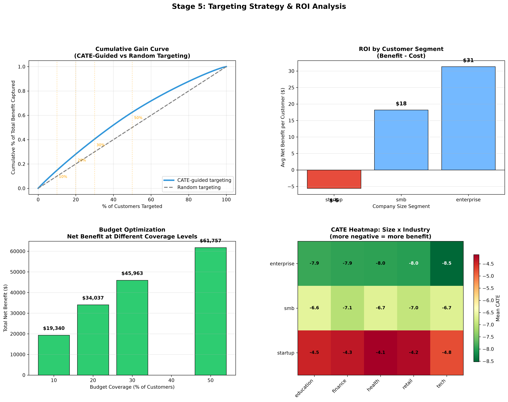
*Stage 6: ROI-optimal targeting based on CATE ranking.*

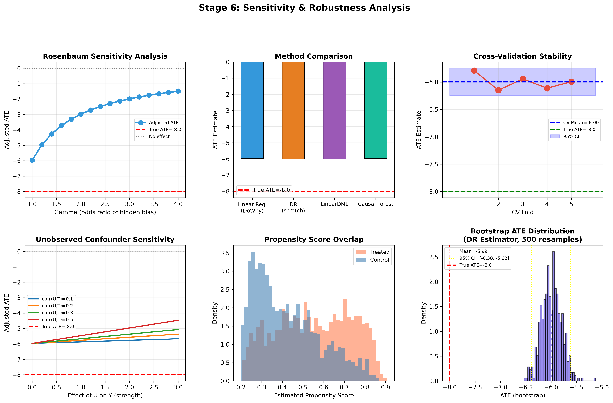
*Stage 7: 5-fold cross-validation and Rosenbaum sensitivity bounds.*

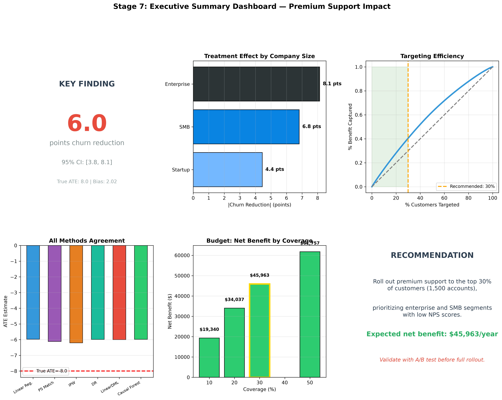
*Stage 8: Business-ready executive summary dashboard.*

---

## Methodology Decisions

- **Why LiNGAM for discovery?** The data-generating process uses Laplace (non-Gaussian) noise, which makes the full DAG identifiable under the LiNGAM assumption. The PC algorithm only recovers the Markov equivalence class (CPDAG), and NOTEARS struggles with mixed variable types.
- **Why 6 estimators?** Triangulation across fundamentally different identification strategies (parametric, semiparametric, machine learning) provides robustness that no single method can offer. If all six agree, the result is credible.
- **Why synthetic data?** Known ground truth enables rigorous evaluation (SHD, F1, ATE bias) that is impossible with real observational data where the true causal effect is unknowable.
- **Why from-scratch implementations?** The PC algorithm and NOTEARS are implemented from scratch (using only `castle.CITest` and `scipy.optimize`) to demonstrate deep understanding of the algorithms, not just API usage.

---

## Tech Stack

| Package | Version | Purpose |
|---------|---------|---------|
| Python | 3.11 | Runtime |
| `dowhy` | 0.14 | Causal identification + estimation framework |
| `econml` | 0.17 | LinearDML, Causal Forest (CATE) |
| `lingam` | latest | DirectLiNGAM causal discovery |
| `castle` | latest | Conditional independence testing (PC algorithm) |
| `scipy` | latest | NOTEARS optimization (`minimize`, `expm`) |
| `numpy` | latest | Numerical computation |
| `pandas` | latest | Data manipulation |
| `matplotlib` | latest | Visualization (14 figures) |
| `networkx` | latest | DAG construction and manipulation |
| `scikit-learn` | latest | ML models, cross-validation |

---

## How to Run

### Part 1: Causal Discovery

```bash
pip install numpy pandas matplotlib networkx scipy scikit-learn lingam castle
python causal_discovery.py
```

Produces `fig1_true_dag.png` through `fig7_discovery_to_estimation.png`.

### Part 2: Comprehensive Capstone

```bash
pip install numpy pandas matplotlib networkx scipy scikit-learn dowhy econml lingam
python capstone.py
```

Produces `fig8_eda.png` through `fig14_executive_summary.png`.

Both scripts are self-contained — they generate synthetic data, run all analyses, and save all figures to the script's directory.

---

## Repository Structure

```
multi-method-causal-replication/
├── README.md              # This file
├── LICENSE                # MIT License
├── .gitignore
├── causal_discovery.py    # Part 1: 3-algorithm causal discovery (~42KB)
├── capstone.py            # Part 2: 8-stage comprehensive pipeline (~64KB)
├── notes.md               # Development notes and methodology decisions
├── fig1_true_dag.png      # Ground-truth healthcare DAG
├── fig2_pc_results.png    # PC algorithm CPDAG
├── fig3_lingam_result.png # DirectLiNGAM perfect recovery
├── fig4_notears_result.png # NOTEARS continuous optimization
├── fig5_algorithm_comparison.png # 3-algorithm comparison
├── fig6_sample_size_effect.png   # SHD vs. sample size
├── fig7_discovery_to_estimation.png # Discovery→DoWhy bridge
├── fig8_eda.png           # SaaS churn EDA
├── fig9_discovered_dag.png # LiNGAM churn DAG
├── fig10_dowhy_estimation.png # 6-method estimation
├── fig11_cate_analysis.png # Heterogeneous effects
├── fig12_targeting_strategy.png # ROI targeting
├── fig13_robustness.png   # Cross-validation + sensitivity
└── fig14_executive_summary.png # Executive dashboard
```

---

## Related Repositories

- **[bayesian-experimentation-reference-implementation](https://github.com/billyjack/bayesian-experimentation-reference-implementation)** — Bayesian A/B testing with PyMC, covering conjugate models, hierarchical models, and decision analysis.
- **[causal-inference-python](https://github.com/billyjack/causal-inference-python)** — Weekly coursework covering the causal inference toolkit: potential outcomes, DAGs, PS/IPW/DR, DML, Causal Forests, IV, DiD, and synthetic control.

---

## License

MIT License. See [LICENSE](LICENSE).
